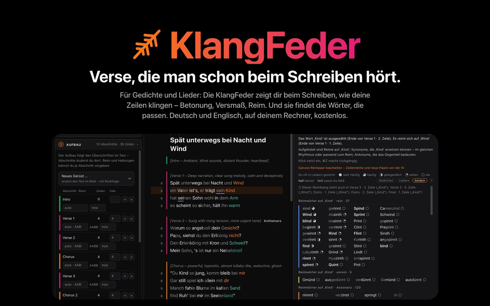
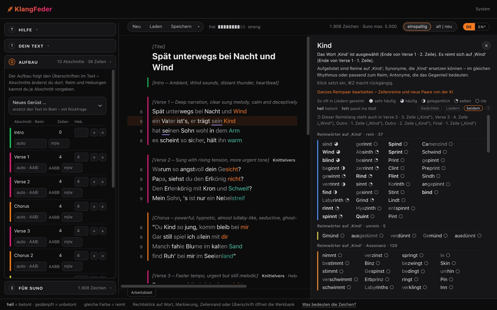

<b>Deutsch</b> · <a href="README.md">English</a>

# KlangFeder

**Verse, die man schon beim Schreiben hört.**
Für Gedichte und Lieder: Die KlangFeder zeigt dir beim Schreiben, wie deine Zeilen klingen – Betonung, Versmaß, Reim.
Und sie findet die Wörter, die passen. Deutsch und Englisch. Kostenlos, ohne Konto, läuft auf deinem eigenen Rechner.

**[Alles, was sie kann → Feature-Seite](https://caspardavi.github.io/klangfeder-releases/?lang=de)**

## Herunterladen

 Setup.exe 22 MB · DMG 78 MB (Intel und Apple Silicon) · .deb 43 MB · andere Linux-Systeme: <a href="https://github.com/CasparDavi/klangfeder-releases/releases/latest/download/KlangFeder-x86_64.AppImage">AppImage</a> 40 MB

**Systemanforderungen.** Ein 64-Bit-Rechner mit Windows 10 oder 11, macOS 11 oder neuer oder Linux (x86_64). Rund
1,5 GB freier Platz für Programm und Wörterbücher. Ein aktueller Webbrowser.

## Was sie kann

- **Betonung sehen.** Betonte Silben leuchten, unbetonte treten zurück. Jede Zeile zeigt ihre Silben, Hebungen und
  Kadenz, jeder Abschnitt sein Versmaß.
- **Reime sehen.** Gleiche Farbe reimt. Das Reimschema steht an jedem Abschnitt (Kreuzreim, Paarreim, Schweifreim …) –
  als Befund oder als Vorgabe.
- **Wörter finden.** Rechtsklick auf ein Wort: Reime darauf, Ersatzwörter im gleichen Maß, Gegenteile und Wendungen.
  Lücken und Platzhalter wie `x-X-x-X` füllt sie mit Wörtern, die genau hineinpassen.
- **Aufbau planen.** Strophen, Refrain, Bridge: Zeilen, Hebungen und Reim je Abschnitt, als Plan oder aus dem Text.
- **Für Suno.** Zählt, was in Sunos Felder passt (Lyrics höchstens 5000 Zeichen, Styles 1000), und legt beides zum
  Kopieren bereit; zusammen mit dem KlangTresor schätzt sie auch die Länge des Lieds.
- **Wahlweise mit KI.** Claude oder ChatGPT schreiben oder überarbeiten mit, über dein eigenes Konto dort. Ohne KI
  läuft die KlangFeder ganz für sich.

## Erste Schritte

1. **Herunterladen und öffnen.** Die Installer sind noch nicht signiert; beim ersten Start fragt das System einmal nach:
   - **Windows:** „Der Computer wurde durch Windows geschützt“ → *Weitere Informationen* → *Trotzdem ausführen*.
   - **macOS:** Wird die App blockiert: Systemeinstellungen → Datenschutz & Sicherheit → *Dennoch öffnen*.
   - **Ubuntu, Debian, Mint:** Doppelklick auf die `.deb`-Datei, im App-Zentrum *Installieren*, dann die KlangFeder
     im Anwendungsmenü starten.
   - **Andere Linux-Systeme (AppImage):** Rechtsklick → Eigenschaften → *Als Programm ausführen* einschalten, dann
     Doppelklick.
2. **Die Wörterbücher holt sie selbst** (rund 350 MB), mit Fortschrittsbalken: unter Windows der Installer selbst,
   auf Mac und Linux die Seite *System*, die beim ersten Start im Browser aufgeht.
3. **Die KlangFeder läuft als Symbol** in Taskleiste, Dock oder Panel. Die Seite liegt unter **http://localhost:8790**.

## Updates

Ist eine neue Fassung da, erscheint neben *System* eine Glocke. Ein Klick auf der Seite *System* spielt sie ein;
deine Texte, Wörterbücher und Einstellungen bleiben, wie sie sind. Einen neueren Installer über eine alte Installation
zu legen, geht ebenso. Die Glocke gibt es ab Fassung 0.9.2.

## Deine Texte

Deine Texte bleiben auf deinem Rechner. Die KlangFeder hat kein Konto, keine Cloud und kein Tracking. Ins Netz geht sie
nur, um ihre Wörterbücher zu holen, um bei GitHub nach einer neuen Fassung zu fragen und – nur wenn du eine KI
einschaltest – um Text und Wunsch an Claude oder ChatGPT zu schicken.

## Fragen

<b>Windows oder macOS sagt, die App sei unsicher.</b>

Die Installer sind noch nicht signiert. Einmal bestätigen, wie unter [Erste Schritte](#erste-schritte) beschrieben.

<b>Ich habe das Browserfenster geschlossen – wie komme ich zurück?</b>

Die KlangFeder läuft weiter, bis du sie über ihr Symbol beendest. Ihr Symbol in Taskleiste, Dock oder Panel (oder ein erneuter Start)
öffnet die Seite wieder; sie liegt unter http://localhost:8790.

<b>Das Holen der Wörterbücher ist abgebrochen.</b>

Die Seite *System* sagt, was fehlt. Den Knopf noch einmal drücken: Was schon angekommen ist, wird fortgesetzt. Ohne Netz lässt sich
das Datenpaket auch als Datei auswählen.

<b>Wie entferne ich sie?</b>

Windows: Einstellungen → Apps → KlangFeder. macOS: die App in den Papierkorb ziehen. Ubuntu, Debian, Mint: im
App-Zentrum entfernen. AppImage: die Datei löschen. Deine Texte und die Wörterbücher bleiben im Ordner `KlangFeder` in
deinem Benutzerordner – lösche ihn, wenn alles weg soll.

## Gut zu wissen

- **Sie schlägt vor, sie entscheidet nicht.** Betonung, Versmaß und Reime sind gerechnet und können irren; das Urteil
  bleibt bei dir.
- **Nicht mit Suno verbunden.** Die KlangFeder gehört nicht zu Suno Inc. Sie zählt nur, was in Sunos Felder passt.
- **Getestet:** Installation unter Ubuntu 24.04 aus diesem Release, ohne Nachhelfen. Windows und macOS sind gebaut,
  der Test einer frischen Installation steht noch aus.

## Lizenz

Die KlangFeder ist kostenlos; ihr Programm steht unter der **MIT-Lizenz**. Wörterbücher und Korpora behalten ihre
eigenen Lizenzen. Die Wörterbücher holt die KlangFeder als Datenpaket; Quellen und Lizenzen stehen vollständig in
`QUELLEN.md` im Paket, unter anderem:

- Wiktionary über ipa-dict (CC BY-SA)
- OpenThesaurus (LGPL 2.1 / CC BY-SA 4.0)
- Open English WordNet (CC BY 4.0)
- CMUdict (BSD)
- Wortschatz Leipzig (CC BY)
- TextGrid (CC BY 3.0 DE)
- Gutenberg Poetry Corpus (CC0)

Abgeleitete Wörterbuchdaten stehen unter derselben Lizenz wie ihre Quelle (CC BY-SA). Im Programm selbst: die
Lautschrift aus Viëtor, *Deutsches Aussprachewörterbuch*, 3. Aufl. 1921 – gemeinfrei, für die KlangFeder digitalisiert
und frei veröffentlicht unter CC0: [github.com/CasparDavi/vietor-1921](https://github.com/CasparDavi/vietor-1921).

Wendungen aus Liedtexten (Songkorpus, IDS Mannheim, CC BY-NC 4.0, „non-commercial scientific research only“) sind
**nicht** im Paket. Wer sie nutzen will, lässt sie die KlangFeder selbst von songkorpus.de holen und stimmt dabei den
Bedingungen des IDS zu.

Die KlangFeder ist von Caspar_D. Große Teile des Codes sind im Dialog mit einem KI-Sprachmodell entstanden; Gestaltung
und Entscheidungen sind von Caspar_D. Dieses Repository enthält nur die Installer und die Landingpage; der Programmcode
wird woanders gepflegt.
