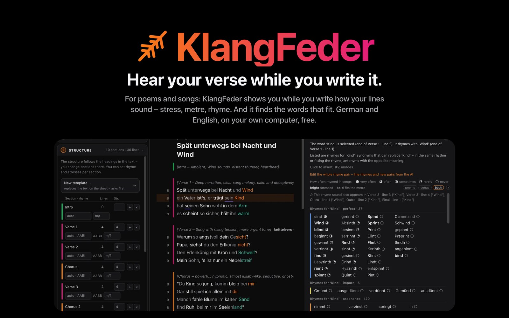
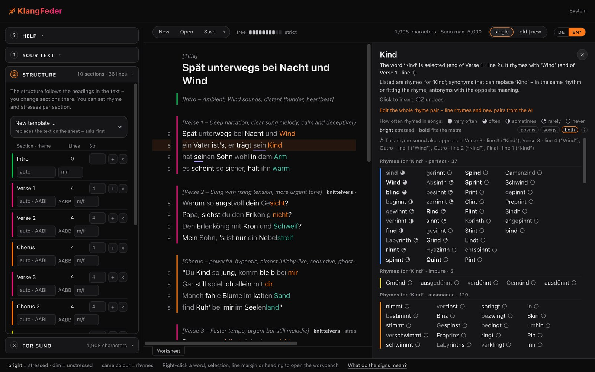

<a href="README.de.md">Deutsch</a> · <b>English</b> · <a href="README.ru.md">Русский</a>

# KlangFeder

**Hear your verse while you write it.**
For poems and songs: KlangFeder shows you while you write how your lines sound – stress, metre, rhyme. And it finds
the words that fit. German, English and Russian. Free, no account, runs on your own computer.

**[See everything it can do → feature page](https://caspardavi.github.io/klangfeder/?lang=en)**

## Download

 Setup.exe 24 MB · DMG 82 MB (Intel and Apple Silicon) · .deb 46 MB · other Linux systems: <a href="https://github.com/CasparDavi/klangfeder/releases/latest/download/KlangFeder-x86_64.AppImage">AppImage</a> 42 MB

**System requirements.** A 64-bit computer with Windows 10 or 11, macOS 11 or newer, or Linux (x86_64). About 1.5 GB
of free space for the program and the dictionaries. A current web browser.

## What it does

- **See the stress.** Stressed syllables light up, unstressed ones step back. Every line shows its syllables, beats
  and cadence, every section its metre.
- **See the rhymes.** Same colour rhymes. Each section shows its rhyme scheme (alternate, couplets, tail rhyme …) –
  as a finding or as a rule.
- **Find words.** Right-click a word: rhymes, replacements with the same stress pattern, opposites and phrases. Gaps
  and placeholders such as `x-X-x-X` are filled with words that fit exactly.
- **Plan the structure.** Verses, chorus, bridge: lines, beats and rhyme per section, as a plan or taken from the text.
- **For Suno.** Counts what fits into Suno’s fields (lyrics at most 5,000 characters, styles 1,000) and has both ready
  to copy; together with KlangTresor it also estimates the length of the song.
- **AI if you like.** Claude or ChatGPT write or revise with you, via your own account there. Without AI, KlangFeder
  runs entirely on its own.

## Getting started

1. **Download and open.** The installers are not signed, so browser and system ask for confirmation once:
   - **Windows:** Edge holds the file back first. In the download list click the **arrow next to *Delete*** → *Keep*
     (if asked: *Keep anyway*). If "Windows protected your PC" appears afterwards: *More info* → *Run anyway*.
   - **macOS:** on the first launch macOS blocks the app. Then System Settings → *Privacy & Security* → at the bottom,
     next to KlangFeder, *Open Anyway* → *Open* once more. After that it starts without asking.
   - **Ubuntu, Debian, Mint:** double-click the `.deb` file, *Install* in the App Center, then start KlangFeder from
     the application menu.
   - **Other Linux systems (AppImage):** right-click → Properties → allow *Executable as Program*, then double-click.
2. **It fetches its dictionaries itself** (about 430 MB), with a progress bar: on Windows the installer itself,
   on Mac and Linux the *System* page that opens in your browser on the first start.
3. **KlangFeder runs as an icon** in the taskbar, Dock or panel. The page is at **http://localhost:8790**.

## Updates

When a new version is out, a bell appears next to *System*. One click on the *System* page installs it; your texts,
dictionaries and settings stay as they are. Running a newer installer over an old installation does the same. The bell
is there from version 0.9.2.

## Your texts

Your texts stay on your computer. KlangFeder has no account, no cloud and no tracking. It goes online only to fetch its
dictionaries, to ask GitHub whether there is a new version, to fetch the Songkorpus from songkorpus.de if you ask for it, and – only if you switch on an AI – to send text and request
to Claude or ChatGPT.

## Questions

<b>Windows or macOS says the app is unsafe.</b>

The installers are not signed. Confirm once as described under [Getting started](#getting-started) – on Windows first
in Edge (arrow next to *Delete* → *Keep*), on macOS in *Privacy & Security* (*Open Anyway*).

<b>I closed the browser window – how do I get back?</b>

KlangFeder keeps running until you quit it via its icon. Its icon in the taskbar, Dock or panel (or starting it again)
opens the page again; it is at http://localhost:8790.

<b>Fetching the dictionaries stopped.</b>

The *System* page says what is missing. Press the button again: what has already arrived is continued. Without a
connection, the data package can also be chosen as a file.

<b>How do I uninstall it?</b>

Windows: Settings → Apps → KlangFeder. macOS: drag the app to the Bin. Ubuntu, Debian, Mint: remove it in the App
Center. AppImage: delete the file. Your texts and the dictionaries stay in the `KlangFeder` folder in your home folder
– delete it if you want everything gone.

## Good to know

- **It suggests, it does not decide.** Stress, metre and rhymes are computed and can be wrong; the judgement stays with
  you.
- **Tested:** installation on Ubuntu 24.04 (AppImage), Windows 11 and macOS 26 (Intel), each with the one step
  from [Getting started](#getting-started): *Keep* in Edge on Windows, *Open Anyway* on macOS. Apple Silicon is built
  in but not yet tested on a real device.

## Licence

KlangFeder is free of charge; its program is released under the **MIT licence**. Dictionaries and corpora keep their
own licences. KlangFeder fetches the dictionaries as a data package; sources and licences are listed in full in
`QUELLEN.md` inside the package, among them:

- Wiktionary via ipa-dict (CC BY-SA)
- OpenThesaurus (LGPL 2.1 / CC BY-SA 4.0)
- Open English WordNet (CC BY 4.0)
- CMUdict (BSD)
- Wortschatz Leipzig (CC BY)
- TextGrid (CC BY 3.0 DE)
- Gutenberg Poetry Corpus (CC0)
- Wiktionary, Russian word forms with stress, synonyms and inflection via kaikki.org (CC BY-SA 4.0)
- Wikisource, Russian poems (public domain)
- Rhyme pairs from about 180,000 Russian songs (Genius via Hugging Face, licence not stated) – only pairs and counts, no lyrics

Derived dictionary data is under the same licence as its source (CC BY-SA). Inside the program: the transcriptions from
Viëtor, *Deutsches Aussprachewörterbuch*, 3rd ed. 1921 – public domain, digitised for KlangFeder and released under
CC0: [github.com/CasparDavi/vietor-1921](https://github.com/CasparDavi/vietor-1921).

Phrases from song lyrics (Songkorpus, IDS Mannheim, CC BY-NC 4.0, "non-commercial scientific research only") are
**not** in the package. If you want them, let KlangFeder fetch them from songkorpus.de itself and agree to the IDS
conditions there.

KlangFeder is made by Caspar_D. Large parts of the code were written in dialogue with an AI language model; design and
decisions are Caspar_D's. This repository holds only the installers and the landing page; the program code is
maintained elsewhere.
