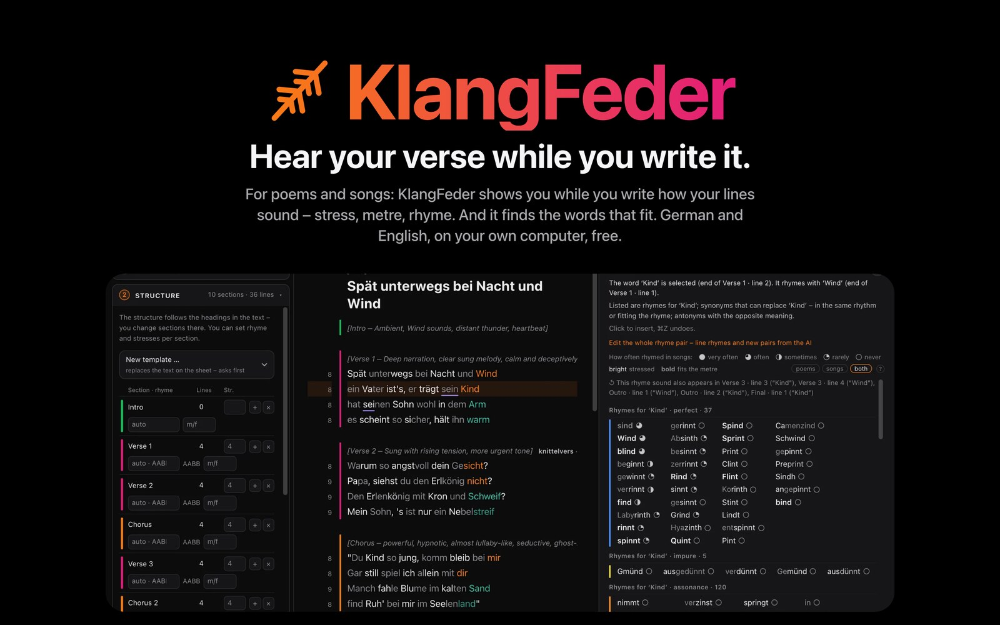
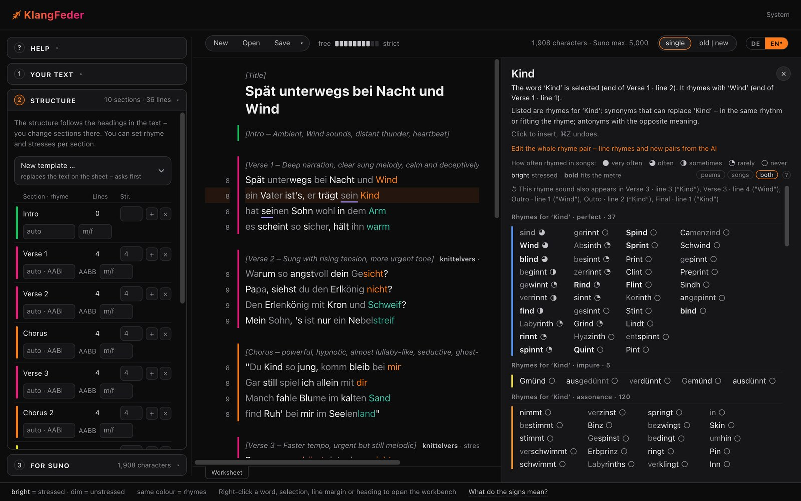

<a href="README.de.md">Deutsch</a> · <a href="README.md">English</a> · <b>Русский</b>

# KlangFeder

**Стихи, которые слышно уже при письме.**
Для стихов и песен: KlangFeder прямо во время письма показывает, как звучат ваши строки, — ударение, размер, рифма.
И находит слова, которые подходят. Немецкий, английский и русский. Бесплатно, без учётной записи, работает на вашем собственном компьютере.

**[Всё, что умеет KlangFeder → страница возможностей](https://caspardavi.github.io/klangfeder/?lang=ru)**

## Скачать

 Setup.exe 24 МБ · DMG 82 МБ (Intel и Apple Silicon) · .deb 46 МБ · другие системы Linux: <a href="https://github.com/CasparDavi/klangfeder/releases/latest/download/KlangFeder-x86_64.AppImage">AppImage</a> 42 МБ

**Системные требования.** 64-битный компьютер с Windows 10 или 11, macOS 11 или новее либо Linux (x86_64). Около
1,5 ГБ свободного места для программы и словарей. Современный веб-браузер.

## Что умеет KlangFeder

- **Видеть ударение.** Ударные слоги светятся, безударные отступают. Каждая строка показывает свои слоги, ударные
  слоги и клаузулу, каждый раздел — свой размер.
- **Видеть рифмы.** Одинаковый цвет — рифма. У каждого раздела указана схема рифмовки (перекрёстная, парная,
  хвостовая…) — как найденная в тексте или как заданная.
- **Находить слова.** Правый клик по слову: рифмы к нему, замены того же размера, антонимы и обороты. Пропуски и
  заполнители вроде `x-X-x-X` KlangFeder заполняет словами, которые встают точно.
- **Планировать структуру.** Куплеты, припев, бридж: строки, ударные слоги и рифма для каждого раздела — как план
  или по тексту.
- **Для Suno.** KlangFeder считает, что помещается в поля Suno (Lyrics — не больше 5000 знаков, Styles — 1000), и
  готовит оба поля к копированию; вместе с KlangTresor оценивает ещё и длительность песни.
- **По желанию — с ИИ.** Claude или ChatGPT пишут или перерабатывают текст вместе с вами — через вашу собственную
  учётную запись там. Без ИИ KlangFeder работает полностью самостоятельно.

## Первые шаги

1. **Скачайте и откройте.** Установщики не подписаны, поэтому браузер и система один раз переспросят:
   - **Windows:** Edge сначала задерживает файл. В списке загрузок нажмите **стрелку рядом с «Удалить»** →
     «Сохранить» (если спросит: «Всё равно сохранить»). Если затем появится «Система Windows защитила ваш
     компьютер»: «Подробнее» → «Выполнить в любом случае».
   - **macOS:** при первом запуске macOS блокирует приложение. Тогда: Системные настройки → «Конфиденциальность и
     безопасность» → в самом низу, рядом с KlangFeder, «Всё равно открыть» → ещё раз «Открыть». После этого
     приложение запускается без вопросов.
   - **Ubuntu, Debian, Mint:** двойной клик по файлу `.deb`, в Центре приложений «Установить», затем запустите
     KlangFeder из меню приложений.
   - **Другие системы Linux (AppImage):** правый клик → Свойства → включите «Выполнять как программу», затем двойной
     клик.
2. **Словари загружаются автоматически** (около 430 МБ), с индикатором прогресса: в Windows это делает сам
   установщик, на Mac и в Linux — страница «Система», которая при первом запуске открывается в браузере.
3. **KlangFeder работает как значок** на панели задач, в Dock или на панели. Страница открывается по адресу
   **http://localhost:8790**.

## Обновления

Когда выходит новая версия, рядом с «Система» появляется колокольчик. Один клик на странице «Система» устанавливает
её; ваши тексты, словари и настройки остаются как есть. Можно также установить более новый установщик поверх старой
установки. Колокольчик есть начиная с версии 0.9.2.

## Ваши тексты

Ваши тексты остаются на вашем компьютере. У KlangFeder нет учётной записи, облака и слежки. В сеть программа выходит
только для того, чтобы загрузить словари, спросить у GitHub, нет ли новой версии, по вашему желанию загрузить корпус
Songkorpus с songkorpus.de и — только если вы включите ИИ — отправить текст и вашу просьбу в Claude или ChatGPT.

## Вопросы

<b>Windows или macOS сообщает, что приложение небезопасно.</b>

Установщики не подписаны. Подтвердите один раз, как описано в разделе [Первые шаги](#первые-шаги): в Windows сначала
в Edge (стрелка рядом с «Удалить» → «Сохранить»), в macOS — в разделе «Конфиденциальность и безопасность» («Всё равно
открыть»).

<b>Я закрыл(а) окно браузера — как вернуться?</b>

KlangFeder продолжает работать, пока вы не завершите её работу через значок программы. Значок на панели задач, в Dock или на
панели (или повторный запуск) снова открывает страницу; она находится по адресу http://localhost:8790.

<b>Загрузка словарей прервалась.</b>

Страница «Система» показывает, чего не хватает. Нажмите кнопку ещё раз: то, что уже загружено, докачивается дальше.
Без интернета пакет данных можно выбрать и как файл.

<b>Как удалить KlangFeder?</b>

Windows: Параметры → Приложения → KlangFeder. macOS: перетащите приложение в Корзину. Ubuntu, Debian, Mint: удалите
в Центре приложений. AppImage: удалите файл. Ваши тексты и словари остаются в папке `KlangFeder` в вашей папке
пользователя — удалите её, если нужно убрать всё.

## Полезно знать

- **KlangFeder предлагает, но не решает.** Ударение, размер и рифмы рассчитаны и могут ошибаться; оценка остаётся за
  вами.
- **Проверено:** установка в Ubuntu 24.04 (AppImage), Windows 11 и macOS 26 (Intel), каждый раз с одним действием из
  раздела [Первые шаги](#первые-шаги): в Windows «Сохранить» в Edge, в macOS «Всё равно открыть». Поддержка Apple
  Silicon встроена, но на настоящем устройстве ещё не проверена.

## Лицензия

KlangFeder — бесплатная программа; её код распространяется по **лицензии MIT**. Словари и корпуса сохраняют свои
собственные лицензии. Словари KlangFeder загружает как пакет данных; источники и лицензии полностью перечислены в файле
`QUELLEN.md` в пакете, среди них:

- Wiktionary через ipa-dict (CC BY-SA)
- OpenThesaurus (LGPL 2.1 / CC BY-SA 4.0)
- Open English WordNet (CC BY 4.0)
- CMUdict (BSD)
- Wortschatz Leipzig (CC BY)
- TextGrid (CC BY 3.0 DE)
- Gutenberg Poetry Corpus (CC0)
- Wiktionary: русские словоформы с ударением, синонимы и словоизменение через kaikki.org (CC BY-SA 4.0)
- Викитека (Wikisource): русские стихи (общественное достояние)
- Пары рифм примерно из 180 000 русских песен (Genius через Hugging Face, лицензия не указана) — только пары и их число, без текстов

Производные данные словарей распространяются по той же лицензии, что и их источник (CC BY-SA). В самой программе:
транскрипция из словаря Viëtor, *Deutsches Aussprachewörterbuch*, 3-е изд. 1921 — общественное достояние, оцифровано
для KlangFeder и опубликовано в открытом доступе под CC0:
[github.com/CasparDavi/vietor-1921](https://github.com/CasparDavi/vietor-1921).

Обороты из немецких текстов песен (Songkorpus, IDS Mannheim, CC BY-NC 4.0, «non-commercial scientific research only»)
в пакет **не входят**. Если они вам нужны, KlangFeder загрузит их с songkorpus.de по вашему запросу; при этом вы соглашаетесь
с условиями IDS.

Автор KlangFeder — Caspar_D. Большая часть кода написана в диалоге с языковой моделью ИИ; оформление и решения —
Caspar_D. В этом репозитории только установщики и страница программы; код программы ведётся в другом месте.
